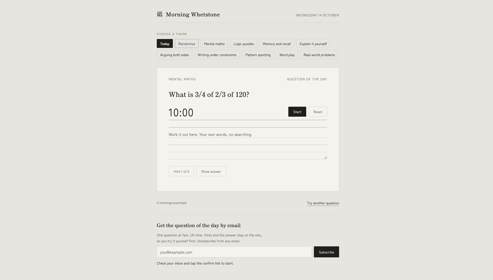

# 砥 Morning Whetstone

**A ten-minute thinking question every morning, to keep your own reasoning sharp when AI does so much of the thinking for us.**

🔗 **Live site:** [brain-whetstone.fun](https://brain-whetstone.fun)



## Motivation

AI tools are being used for things we once did by ourselves like summarise my reading, editing my writing, and helping me make decisions. That's useful, but I noticed I was reaching for them before thinking things through myself. Morning Whetstone is a small daily habit to push back on that by asking one question that scratches your brain, for a maximum of 10 minutes, no searching and no AI, before the day starts.

## Features

- **Question of the day.** Everyone gets the same question each day, chosen from a bank of 287.
- **Nine themes.** Mental maths, logic puzzles, memory and recall, explain it yourself, arguing both sides, writing under constraints, pattern spotting, word play and real-world problems. Pick a theme, or randomise. The questions were made to be answered within 10 minutes, and the complexity of questions ranges from easy (done within 1 minute) to hard (over 5 minutes), so you will never know what to expect every morning.
- **10-minute timer** with a soft chime, and space to write out your working.
- **Up to three hints**, revealed one at a time, then the answer. Revealing the answer early takes a second tap.
- **Daily email at 7am UK time.** Sign up with an email address, confirm it, and the question arrives each morning. The email contains only the question, and the hints and answer stay on the site.
- **Streak counter** to track consecutive mornings.
- **Installable on a phone** like an app, and works offline after the first visit.
- **Light and dark mode**, with a quiet, paper-like design inspired by Japanese and Scandinavian minimalism.

## How it works

```
Browser ──► Cloudflare Worker ──► static site (HTML, CSS, JS)
                │
                ├── /api/subscribe ──► D1 database (subscribers) ──► Resend (confirmation email)
                ├── /api/confirm
                └── /api/unsubscribe
Cron trigger (daily) ──► Worker ──► picks today's question ──► Resend (daily email)
```

| Part | Technology |
|---|---|
| Hosting and backend | Cloudflare Workers, serving the site and a small API |
| Database | Cloudflare D1 (SQLite), storing subscriber emails only |
| Scheduling | Cloudflare cron triggers |
| Email | Resend, with SPF, DKIM and DMARC on a custom domain |
| Front end | Plain HTML, CSS and JavaScript, no framework |
| Offline and install | Service worker and web app manifest |

### Design decisions

- **One shared question per day.** Questions are shuffled once with a fixed seed, then picked by London date, so the site and the email always agree and every question appears before any repeats.
- **7am all year round.** The cron runs at 05:00 and 06:00 UTC, and the Worker only sends on the run that falls at 7am London time. This handles the switch between GMT and BST.
- **No duplicate emails.** Each subscriber's last-sent date is recorded, so a retried job can't send the same question twice.
- **Double opt-in and easy unsubscribe.** People confirm their email before receiving anything. Every email has an unsubscribe link and supports one-click unsubscribe in Gmail and Apple Mail.
- **Privacy.** Only the email address is stored. Streaks and progress live in the visitor's own browser.
- **Spam protection.** The sign-up form has a hidden field that catches bots.

## How it was made

I built this with Claude. It's a bit of an irony: a tool against over-relying on AI, made with AI.

**My part:** the idea; choosing and refining the question themes; the design direction; deciding the features (hints, timer, daily email); buying and configuring the domain, including the DNS records for email authentication; and deploying to Cloudflare with automatic deploys from GitHub.

**Claude's part:** writing most of the code and drafting the question bank, which I reviewed and revised.

## Project structure

```
public/
  index.html            the website
  questions.js          question bank and question-of-the-day logic
  sw.js                 offline support
  manifest.webmanifest  phone install settings
src/
  worker.js             API, daily email job and email templates
schema.sql              subscriber table
wrangler.toml           Cloudflare configuration
```

## Run your own copy

<details>
<summary>Setup instructions</summary>

**You'll need:** Node.js, a free Cloudflare account, a free Resend account, and a domain to send email from.

1. **Install**
   ```
   npm install
   npx wrangler login
   ```
2. **Create the database**
   ```
   npx wrangler d1 create whetstone
   ```
   Put the printed `database_id` into `wrangler.toml`, then run:
   ```
   npm run db:init
   ```
3. **Set up email**
   - In Resend, add and verify your domain. If your DNS is on Cloudflare, set the email records to **DNS only** (grey cloud), not Proxied.
   - Create an API key, then run:
     ```
     npx wrangler secret put RESEND_API_KEY
     ```
4. **Configure** `SITE_URL` and `FROM_EMAIL` in `wrangler.toml`.
5. **Deploy**
   ```
   npm run deploy
   ```
   Then add your domain under the Worker's **Settings → Domains & Routes**.

**Run locally**
```
npm run db:init:local
npm run dev
```

**Edit questions** in `public/questions.js`. Each question looks like:
```js
{q:"The question", h:["Hint 1","Hint 2","Hint 3"], a:"The answer"},
```

**Free plan limits:** Resend's free plan sends 100 emails a day, which covers about 100 subscribers.

</details>

## Ideas for later

- **AI answer feedback.** After you've written your own answer, an LLM reviews it against the model answer and comments on your reasoning: what you got right, where your logic slipped, and one thing to try next time. It would never give hints or the answer before you've attempted it, so the thinking stays yours.
- A biology and bioinformatics theme
- Difficulty levels
- Streaks that follow you across devices
- An archive of past questions
